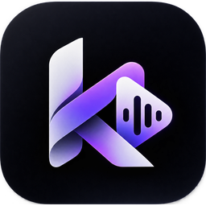

  
  <h1>K4 Music</h1>
  
<b>Your music. Every screen.</b> A free, ad-free music player for Android and Windows by Kartik Langwan.

  
  

---

This repository only hosts the **downloads** (APK and Windows installer) for every K4 Music release, so they can be shared publicly and the Windows app can update itself. Grab them from [**Releases**](https://github.com/KartikLangwan/K4Music-releases/releases) or the website.

| | File | Requires |
| --- | --- | --- |
| **Android** | `K4Music-v<version>-RELEASE.apk` | Android 7.0+, arm64-v8a or x86_64 |
| **Windows** | `K4Music-Setup-<version>.exe` | Windows 10 / 11, 64-bit |

Each release lists the SHA-256 of both files.

**Android:** open the APK and allow *Install unknown apps* for your browser when Android asks.
**Windows:** run the installer (no admin rights needed). It isn't code-signed yet, so on *Windows protected your PC* choose **More info → Run anyway**. Updates: Settings → Check for updates → **Update now**.

No ads · no account · no tracking. Made by [Kartik Langwan](https://kartiklangwan.vercel.app) · [@K4RTIK.nvm](https://www.instagram.com/K4RTIK.nvm/)

K4 Music is an independent project and is not affiliated with YouTube, Google, JioSaavn or Spotify.
